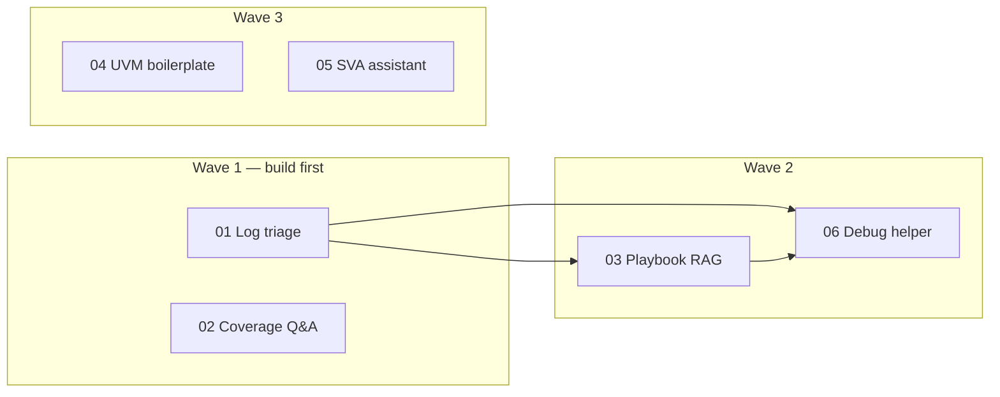

# DV AI tools roadmap

Index of proposed MVPs for **ai_dv_tools**, ranked by **落地性 (implementability)** and **daily utility**. Assumptions and open questions: [project-context.md](./project-context.md).

## Ranked tools

| Rank | Tool | Spec | Build first? | Rationale (short) |
|------|------|------|----------------|-------------------|
| 1 | Regression / sim log triage & clustering | [01-regression-log-triage.md](./tools/01-regression-log-triage.md) | **Yes** | Pure log I/O, no EDA license; hits every regression day. |
| 2 | URG coverage Q&A & gap summarizer | [02-coverage-urg-qa.md](./tools/02-coverage-urg-qa.md) | **Yes** | Structured URG/text parse + grounded Q&A; high value at closure. |
| 3 | Failure signature → playbook matcher | [03-failure-signature-playbook.md](./tools/03-failure-signature-playbook.md) | No | Strong ROI after triage exists; needs corpus hygiene. |
| 4 | UVM agent/sequence boilerplate | [04-uvm-boilerplate-generator.md](./tools/04-uvm-boilerplate-generator.md) | No | Template-first MVP; LLM only for safe parts. |
| 5 | SVA draft from English + signal list | [05-sva-draft-assistant.md](./tools/05-sva-draft-assistant.md) | No | Useful but higher review/hallucination burden. |
| 6 | Waveform-less debug helper | [06-waveform-less-debug-helper.md](./tools/06-waveform-less-debug-helper.md) | No | Best as add-on to triage + playbook rules. |

## Suggested implementation waves

**Wave 1:** Ship **01** and **02** as Python CLIs with offline-friendly defaults.  
**Wave 2:** **03** consumes triage signatures; **06** reuses triage snippets + playbook retrieval.  
**Wave 3:** **04** and **05** after style templates and signal-list workflows are agreed in [project-context.md](./project-context.md).

## Cross-tool dependencies

- **01 → 03, 06:** Shared normalized failure fingerprints.
- **02:** Independent; optional link from gap summary to suggested tests in **04** later.
- **05:** Keep isolated from RTL write paths; human review gate.

## Document map

| Path | Description |
|------|-------------|
| `/cursor/stores/self/docs/project-context.md` | Workflow assumptions & open questions |
| `/cursor/stores/self/docs/dv-ai-tools-roadmap.md` | This index |
| `/cursor/stores/self/docs/tools/01-regression-log-triage.md` | Tool spec |
| `/cursor/stores/self/docs/tools/02-coverage-urg-qa.md` | Tool spec |
| `/cursor/stores/self/docs/tools/03-failure-signature-playbook.md` | Tool spec |
| `/cursor/stores/self/docs/tools/04-uvm-boilerplate-generator.md` | Tool spec |
| `/cursor/stores/self/docs/tools/05-sva-draft-assistant.md` | Tool spec |
| `/cursor/stores/self/docs/tools/06-waveform-less-debug-helper.md` | Tool spec |